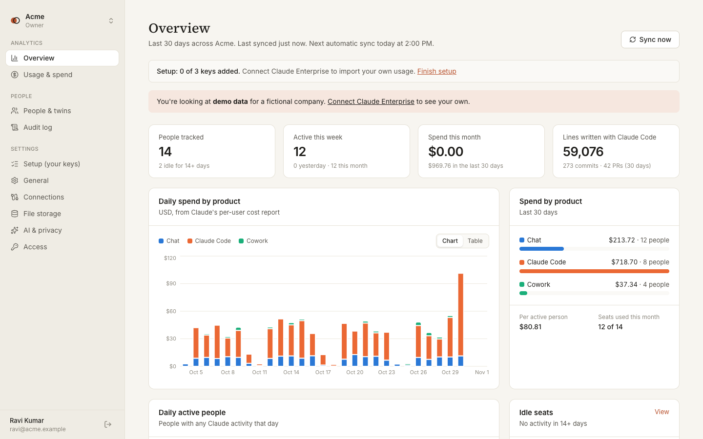
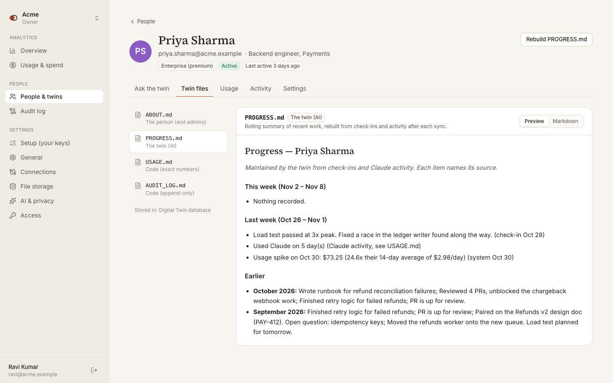
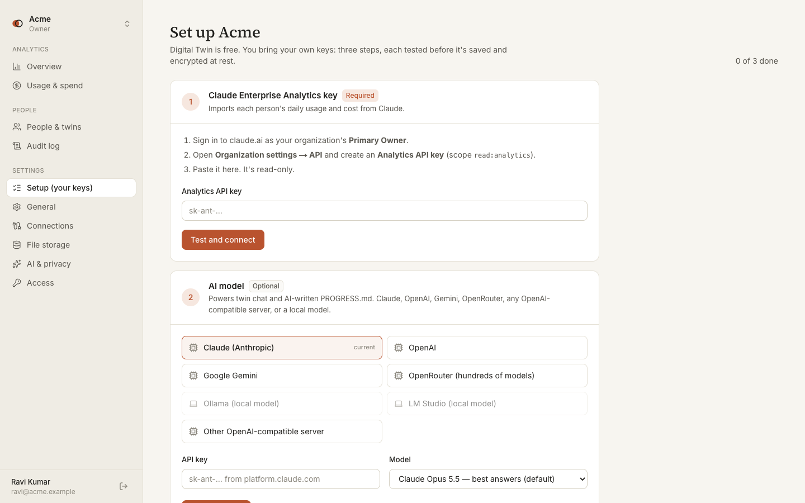

# Digital Twin

**Every AI seat, every dollar, every person — with a twin you can ask.**

A free, open-source dashboard for companies that pay for AI seats (starting with **Claude Enterprise**). It splits usage and cost per person and team, and gives every person a **digital twin**: a folder of markdown files the company owner can chat with ("What has Priya been working on this week?").



| A twin's files | Setup: bring your own keys |
|---|---|
|  |  |

Built by [hardcore-normalized](https://github.com/hardcore-normalized) as a student project. Digital Twin is an independent project and is not affiliated with or endorsed by Anthropic; "Claude" is a trademark of Anthropic.

> **Status:** everything runs with the built-in demo company. The Claude Enterprise integration follows Anthropic's official SDK and Analytics API docs but hasn't been tested against a live Enterprise organization yet.

## Free: bring your own keys

Digital Twin has no plans, seats or billing. When a company creates its zone, the **Setup** page asks for three keys (only the first is required). Each is tested before saving and encrypted at rest:

| Step | Key | Options |
|---|---|---|
| 1 | Claude Enterprise Analytics key (required) | Created by the Primary Owner in claude.ai → Organization settings → API |
| 2 | AI model key (optional) | Claude (Anthropic SDK), or any OpenAI-compatible server: OpenAI, Gemini, OpenRouter, vLLM, **Ollama** or **LM Studio** on localhost (no key needed). One key powers both twin chat and PROGRESS.md. |
| 3 | Storage key (optional) | The app's database (default), an S3-compatible bucket, your own storage API (localhost works), or a **folder on the server** |

**Local models and storage** run on the machine that runs Digital Twin, so they only work while it's on. When they're unreachable, usage still imports, twin chat shows a clear "can't reach your model" message, PROGRESS.md falls back to a plain summary, and storage errors are reported instead of crashing the sync. If the app is hosted on a cloud server, `localhost` means that server, not your laptop.

Local addresses and folders are allowed in development, and in production only with `ALLOW_LOCAL_ENDPOINTS=true` (they'd let users reach into a shared server otherwise). If you self-host, you can also set `ANTHROPIC_API_KEY` as a server-wide default Claude key; a zone's own settings always win.

## Quick start

You need [Node.js](https://nodejs.org) 20 or newer.

```bash
git clone https://github.com/hardcore-normalized/Digital-Twin.git
cd Digital-Twin
npm install && npm run dev   # creates .env.local with fresh secrets on first run
```

Open the URL Next prints (http://localhost:3000, or 3001 if 3000 is busy), create an account, and pick **Explore with demo data**. That creates a fictional 14-person company with 45 days of usage, check-ins and twins.

No database setup is needed locally: an embedded Postgres (PGlite) stores data in `.data/pglite`. Delete that folder to start over.

To turn on twin chat and AI-written PROGRESS.md files, add an AI model in **Setup** or **Settings → AI & privacy**.

If Digital Twin is useful to you, please ⭐ [star the repo](https://github.com/hardcore-normalized/Digital-Twin): it helps other people find it.

## How it works

```
Claude Enterprise Analytics API ──┐
Check-ins from people ────────────┼─► database (people, usage_daily, events, audit_events)
Admin edits ──────────────────────┘          │
                                             ▼  sync job (daily, or "Sync now")
                         twins/<email>/ABOUT.md       written by the person, AI never edits
                                       PROGRESS.md    Claude folds in new events (plain fallback without a key)
                                       USAGE.md       generated by code, exact numbers
                                       AUDIT_LOG.md   generated by code, append-only
                                             │
                     Twin chat (Claude + tools) ◄┘   get_usage · compare_with_team · read_file · list_events
```

- **Raw data is the source of truth.** Twin files are short summaries that can be rebuilt any time (person page → "Rebuild PROGRESS.md").
- **Numbers come from tools, never from the model's memory.** The twin queries `usage_daily` for any cost or count.
- **Transparency.** Every question asked to a twin is written to that person's AUDIT_LOG.md, which they can read from **My twin**. People see only their own twin; owners and admins see everyone.

## Signing in

People can sign up and sign in with:

| Method | How to turn it on |
|---|---|
| Email and password | Always on. Verification emails go through `SMTP_URL`, or are printed to the server log if it isn't set. |
| Google, Microsoft, Apple, GitHub, Slack | Set that provider's `*_CLIENT_ID` and `*_CLIENT_SECRET` (see `.env.example`). Register `<BETTER_AUTH_URL>/api/auth/callback/<provider>` as the redirect URL. |
| Passkeys (Face ID, Touch ID, Windows Hello) | Always on. People add one from **Your account** (click your name in the sidebar). |
| Company SSO (OIDC) | A zone admin sets it up in **Settings → Access**. It turns on after the company adds a DNS TXT record proving it owns the email domain. Microsoft Entra and Google are trusted identity providers by default; add others (Okta, Auth0, Keycloak) with `SSO_TRUSTED_ISSUERS`. |

**Email ownership matters.** Invites and access to your own twin are granted only to verified email addresses: anyone signing in with a social provider, or through domain-verified SSO, is verified automatically; password users verify by email. This stops someone from signing up with another person's address to claim their access.

The SSO plugin stores each provider's client secret in the database (`sso_provider.oidc_config`), so protect database access accordingly.

## Main pieces

| Path | What it does |
|---|---|
| `src/lib/providers/claude-enterprise.ts` | Pulls per-user daily activity (`analytics.users`) and per-user cost (`analytics.userCostReport`) with an Analytics API key |
| `src/lib/providers/demo.ts` | Deterministic fictional company for demos |
| `src/lib/sync/index.ts` | Imports a batch, creates events, flags usage spikes (≥3× the 14-day average and ≥$5), refreshes twins |
| `src/lib/twin/files.ts` | File paths, templates, version history, USAGE/AUDIT rendering |
| `src/lib/ai/` | Bring-your-own AI model: presets, Claude backend (Anthropic SDK), OpenAI-compatible backend (any provider or local model), local-endpoint policy |
| `src/lib/twin/progress.ts` | AI call that rewrites PROGRESS.md (validated before saving) |
| `src/lib/twin/chat.ts` | Streaming twin chat with tool use; conversations persisted per user |
| `src/lib/storage/` | Pluggable file storage: built-in database, S3-compatible bucket, the customer's own HTTP API, or a local folder |
| `src/lib/actions.ts` | Server actions behind every form |
| `src/app/(marketing)` | Public website: landing (with the free / bring-your-own-keys section), security, storage API docs |
| `src/app/app/[zone]` | The dashboard |

## Customer-owned storage

Customers can keep twin files out of our database:

- **S3-compatible bucket** (AWS S3, Cloudflare R2, MinIO).
- **Their own API**: four endpoints (`GET /files?prefix=`, `GET`/`PUT`/`DELETE /files/<path>`) with a bearer token. The contract is documented at `/docs/storage-api`, and a dependency-free reference server is included:

```bash
STORAGE_TOKEN=change-me PORT=4100 npm run storage-api:example
```

Switching storage tests the new backend first (write → read → delete) and can copy existing files over. Credentials and API keys are encrypted at rest with AES-256-GCM (`ENCRYPTION_KEY`).

## Connecting Claude Enterprise

1. The organization's **Primary Owner** opens claude.ai → Organization settings → API, enables API access and creates an **Analytics API key** (`read:analytics`).
2. Paste it in **Settings → Connections**. It's tested before saving.
3. Activity for a day is published around 13:00–13:30 UTC the next day; cost within ~4–24 hours, revisable until ~7 days after month end. Each sync re-reads a short overlap window.

## Hero video

The landing page's 38-second product tour is a [HyperFrames](https://hyperframes.heygen.com) project in `hero-video/` (HTML + GSAP, one scene per file in `hero-video/compositions/`). It leads with digital twins (`hook`, `what`, `twins`, `ask`, `audit`), then usage monitoring (`dashboard`, `seats`), and ends on the `outro`. Scene cuts sit on 2-second bars of the music.

- Rendered file: `public/hero/digital-twin-hero.mp4`, plus `public/hero/poster.jpg` for before it loads and for visitors who prefer reduced motion. It autoplays muted with Sound and Pause buttons.
- Music: `hero-video/assets/music/lofi-house.mp3`, an instrumental lo-fi house track (120 BPM, A minor) generated with [ACE-Step 1.5](https://github.com/ace-step/ACE-Step-1.5) through its cloud API. To make a new one, use the `acestep` skill in the ACE-Step repo, replace the file, then run `hyperframes beats` to refresh the beat grid.
- To edit: open `hero-video/` in the HyperFrames app (or edit the HTML), then re-render into `public/hero/digital-twin-hero.mp4`. Colours are variables in `hero-video/index.html`.

## The public website

The same codebase also serves the project's homepage in **website-only mode**: just the landing, security and docs pages, with "Download from GitHub" and "Star on GitHub" buttons. There's no database, no sign-in and no secrets. Links to the app (`/app`, `/sign-in`, `/sign-up`, `/api/*`) redirect to this repository.

Website-only mode turns on automatically when the app is deployed on Vercel **without** a `DATABASE_URL`, so deploying the website is: import this repo on [vercel.com](https://vercel.com/new) and click **Deploy**, with no settings needed. Force it either way with `SITE_ONLY=true` or `SITE_ONLY=false`. The star count on the site is fetched from GitHub and refreshed hourly.

## Production

- Set `DATABASE_URL` to a real Postgres database. Migrations in `drizzle/` run automatically on first connection.
- Set `BETTER_AUTH_URL` to the public URL, plus `BETTER_AUTH_SECRET`, `ENCRYPTION_KEY` and `CRON_SECRET`.
- **Automatic sync** runs inside the server: each zone syncs once a day at its own time (default 2:00 PM in the creator's timezone; admins change it in Settings → Connections). If the server was down at that time, the sync runs as soon as it's back; a failed sync retries hourly. On serverless hosting, or with several server instances, set `DISABLE_SCHEDULER=true` and call `curl -H "Authorization: Bearer $CRON_SECRET" https://<app>/api/cron/sync` every 15 minutes instead (it runs only the zones that are due; add `?all=1` to sync every zone now).
- Optional: `GOOGLE_CLIENT_ID/SECRET` and `MICROSOFT_CLIENT_ID/SECRET` show "Continue with Google/Microsoft" on the sign-in page.

After changing `src/lib/db/schema.ts`, run `npm run db:generate` to create a new migration.

## Not built yet

- Other providers (ChatGPT Enterprise, Copilot, Cursor) and GitHub/Jira as twin sources.
- Password reset emails and invite emails (verification emails are in place).
- A background queue for large zones (sync currently runs inside the request).
